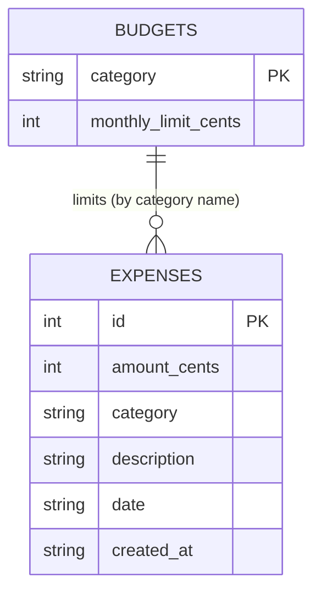
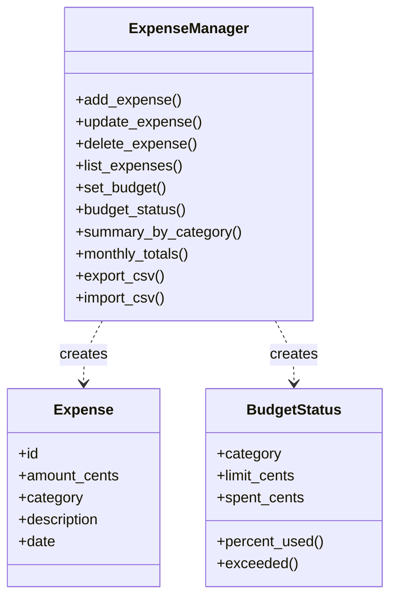

# Design Document – Personal Expense Manager

## 1. Problem Statement
People often lose track of where their money goes. This project provides a lightweight tool to record expenses, enforce monthly category budgets, and generate summaries.

## 2. Requirements

### Functional
| ID | Requirement |
|----|-------------|
| FR1 | User can add an expense (amount, category, description, date) |
| FR2 | User can view, filter and search expenses |
| FR3 | User can edit and delete an expense |
| FR4 | User can set a monthly budget per category |
| FR5 | System shows budget usage and flags overspending |
| FR6 | System generates category and monthly reports |
| FR7 | User can import/export data as CSV |

### Non-Functional
| ID | Requirement |
|----|-------------|
| NFR1 | Monetary values must be exact (integer cents) |
| NFR2 | Data persists locally between sessions (SQLite) |
| NFR3 | Invalid input yields clear errors, never a crash |
| NFR4 | No third-party runtime dependencies |
| NFR5 | Core logic covered by automated tests |

## 3. Use Cases
- **UC1 Record expense** – User → `add` → system validates → stores → confirms.
- **UC2 Review spending** – User → `list`/`report` → system queries and displays.
- **UC3 Control budget** – User → `budget set` → later `budget status` shows % used and OVER BUDGET alerts.
- **UC4 Backup data** – User → `export` / `import` CSV.

## 4. Architecture
Three layers: **CLI (presentation) → Services (business logic) → Database (persistence)**. The CLI never touches SQL; services never print. This makes the logic unit-testable and lets a web UI be added later without changing services.

## 5. Database Design (ER Diagram)

## 6. Class Diagram

## 7. Key Design Decisions
- **Integer cents** instead of floats: `0.1 + 0.2 != 0.3` in floating point; cents avoid rounding drift.
- **SQLite**: serverless, ships with Python, ACID-safe.
- **Categories normalised to lowercase** so "Food" and "food" aren't split.
- **Parameterised SQL** everywhere to prevent SQL injection.

## 8. Test Plan
| Area | Tests |
|------|-------|
| Validation | invalid amounts, dates, empty category |
| CRUD | add/get/update/delete, not-found error |
| Filtering | category, month, keyword, date range |
| Budgets | overspend detection, month isolation, overwrite limit |
| Reports | category ranking, monthly totals |
| Precision | repeated 0.10 additions equal exactly 0.30 |
| I/O | CSV round-trip with commas in text |
| CLI | end-to-end add/list/delete and error exit code |

Run: `pytest -v` (14 tests).
